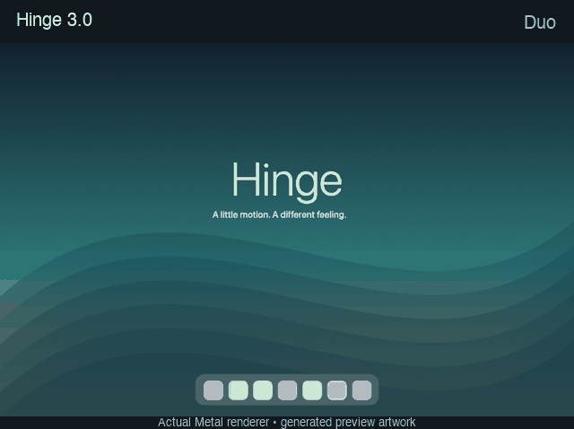

# Hinge

Project repository: [Numericss/Hinge](https://github.com/Numericss/Hinge).

A native macOS desktop-effects app that responds to a compatible MacBook lid sensor. Working product name. Version **3.0.0** is the Gumroad customer target: buyers receive a **Developer ID–signed, Apple-notarized** ZIP produced on the seller’s Mac (not an ad-hoc local build).



*Five effects rendered by Hinge 3.0 using generated preview artwork. This demonstrates the renderer, not a recording of physical lid movement or desktop capture.*

## Version 3.0

- Five inherited Swift + Metal effects: Duo, Roll, Shutter, Flex, and Iris.
- New Subtle, Cinematic, and Crisp motion presets.
- Named local presets with save, rename, delete, and migration of the existing favorite.
- Quick menu-bar panel for effects, presets, performance, and pause.
- Battery Saver, Balanced, and Smooth performance modes with battery-aware frame and capture limits.
- Optional automatic pause for selected foreground apps or a connected external display.
- Guided initial setup, optional launch at login, and local diagnostics export.
- New calibration to your normal working lid angle.
- Native sidebar with Effects, Motion, Automation, and Setup & Help pages.
- Larger effect choices, one-click replay, a stoppable preview, and readable persistent status.
- Teal visual identity, original geometric icon, and in-app attribution.
- Desktop tests return to their prior on/off state; saved settings are validated on launch.
- Independent app identity and preferences so it can coexist with MacDuo.
- Developer ID signing and notarization packaging script for direct distribution.

Requires macOS 14+, Apple silicon, and a compatible MacBook lid sensor for automatic effects. External displays are not animated. A generated-artwork preview works without Screen Recording permission; animating the real desktop requires permission. No account, analytics, or network service is added. Frames remain in memory on the Mac.

## Build and test

```sh
swift test
./build.sh
open "$HOME/Library/Caches/Hinge/build/Hinge.app"
"$HOME/Library/Caches/Hinge/build/Hinge.app/Contents/MacOS/Hinge" --render-check validation
```

Tests require a full Xcode installation. If your active toolchain is Command Line Tools, run with `DEVELOPER_DIR=/Applications/Xcode-beta.app/Contents/Developer` (adjust for your Xcode location).

Signed app bundles are built in `~/Library/Caches/Hinge/build` to avoid file-provider metadata in synced Documents folders. Override with `HINGE_OUTPUT_DIR` if needed.

The default `./build.sh` is **ad-hoc signed for local development**. Do not upload that build as the paid Gumroad download. Customer ZIPs must be notarized via the release script below.

Optional at build time: `HINGE_SUPPORT_EMAIL=you@example.com` embeds a Support mailto in About (see [release/CHECKLIST.md](release/CHECKLIST.md)).

Open **Motion** for named presets and calibration. **Automation** controls performance, pause rules, and launch at login. **Effects** provides one-click selection and replay. **Setup & Help** explains permissions and the temporary desktop test. Manual preview changes the preview only; Pause Hinge controls the actual desktop. Enable Hinge only when ready to grant screen access. Esc and Control–Option–Command–F pause the desktop overlay.

## Release

Customer product notes: [release/V3.0-CUSTOMER.md](release/V3.0-CUSTOMER.md).  
Seller checklist (pre-payment → Mac packaging → Gumroad): [release/CHECKLIST.md](release/CHECKLIST.md).  
Gumroad listing draft (placeholders for price / support / hardware): [release/GUMROAD.md](release/GUMROAD.md).  
Historical 3.0 development-preview validation: [release/V3-PREVIEW.md](release/V3-PREVIEW.md).  
Development notes: [docs/DEVELOPMENT.md](docs/DEVELOPMENT.md).

Customer packaging (Developer ID + notarytool — run on a Mac with certificates configured):

```sh
export HINGE_SIGNING_IDENTITY='Developer ID Application: Your Name (TEAMID)'
export HINGE_NOTARY_PROFILE='your-keychain-profile'
export HINGE_SUPPORT_EMAIL='[SUPPORT_EMAIL]'   # optional; recommended for buyers
./scripts/package-release.sh
```

Output: `build/distribution/Hinge-3.0.0.zip` and `.sha256`. The script refuses to run without a Developer ID identity and notary profile, and only writes the customer ZIP after notarization, stapling, and Gatekeeper assessment succeed.

## Credits and license

Hinge is a modified distribution of [MacDuo](https://github.com/DhananjayBhosale/MacDuo), copyright 2026 Mac Duo contributors, licensed under MIT. Its core rendering, capture, and sensor implementation are inherited. The license and attribution are retained in the repository and bundled app. See [LICENSE](LICENSE) and [ATTRIBUTION.md](ATTRIBUTION.md). Independent software, not affiliated with Apple or the upstream authors.
